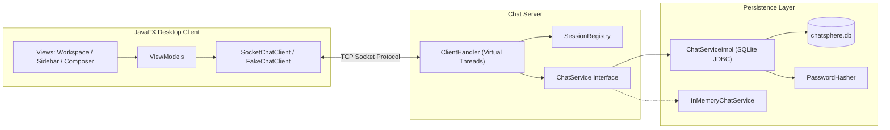

# ChatSphere

[](https://openjdk.org/projects/jdk/21/)
[](https://openjfx.io/)
[](#testing)
[](LICENSE)

**ChatSphere** is a high-performance desktop chat platform written in **Java 21**. It features a modern **JavaFX** client, a concurrent virtual-thread socket server, and dual-backend persistence (SQLite JDBC and In-Memory specification).

---

## Table of Contents

- [Features](#features)
- [Architecture](#architecture)
- [Tech Stack & Prerequisites](#tech-stack--prerequisites)
- [Getting Started](#getting-started)
  - [Build from source](#build-from-source)
  - [Run the Server](#run-the-server)
  - [Run the Client](#run-the-client)
  - [Run Standalone Client (Mock Mode)](#run-standalone-client-mock-mode)
  - [Classroom demo over LAN](#classroom-demo-over-lan)
- [Testing](#testing)
- [Project Structure](#project-structure)
- [Protocol Overview](#protocol-overview)

---

## Features

### Client (JavaFX UI)
- **Modern Workspace Layout:** Multi-column interface featuring responsive channel/user sidebar, conversation stream, message composer, and contextual details/search inspector.
- **Optimistic UI:** Messages appear instantly upon sending with optimistic state transitions (`PENDING` ➔ `SENT` ➔ `DELIVERED` ➔ `READ`).
- **Smart Stream Grouping:** Bubbles group dynamically by sender within temporal windows (5-minute proximity), with automatic day separators and unread dividers.
- **LAN file and image sharing:** Attach a file of up to 5 MiB to a room or direct message. Recipients can save the original bytes from chat history. Filenames are searchable.
- **Real-Time Indicators:** Ephemeral typing strips and live presence indicators (online/offline tracking).
- **History & Scoped Search:** Paginated message retrieval and full-text keyword search with substring marking, sender/date filters, and conversation scoping.
- **Adaptive Design System:** Light and Dark themes backed by custom CSS tokens, typography scale, and avatar color hashing.

### Server & Backend
- **High-Concurrency Socket Engine:** Virtual-thread-per-connection server architecture with outbound queue management, non-blocking broadcasts, and graceful slow-client disconnect handling.
- **Dual Persistence Contract:**
  - **SQLite:** Transactional persistence using SQLite JDBC and prepared statements in `UserDAO`, `RoomDAO`, and `MessageDAO`. Messages and their attachment data are stored in the same transaction.
  - **In-Memory (Testing & Dev):** Concurrent zero-dependency in-memory service mirroring the exact SQLite specification.
- **Security:** PBKDF2 password hashing with constant-time verification to prevent timing attacks.

---

## Architecture



---

## Tech Stack & Prerequisites

- **Language:** Java 21 LTS
- **GUI Framework:** JavaFX 21 (`javafx-controls`, `javafx-fxml`, `javafx-graphics`)
- **Icons:** Ikonli (`ikonli-feather-pack`, `ikonli-javafx`)
- **Database:** SQLite JDBC (`sqlite-jdbc`)
- **Testing:** JUnit 5 (`junit-jupiter`)
- **Build Tool:** Apache Maven 3.9+

---

## Getting Started

### Build from source

Extract the ChatSphere source ZIP and open the folder containing `pom.xml`. Use a **JDK 21**. Confirm it with `java -version` and `javac -version`. Run `./mvnw clean verify` on Linux or macOS, or `mvnw.cmd clean verify` on Windows. The wrapper downloads Maven and dependencies on the first online run.

For the portable download, extract the ZIP for your platform and follow [the local verification walkthrough](docs/VERIFY.md). The portable launchers only require an installed Java runtime.

On Windows use `mvnw.cmd` in place of `./mvnw` for every source command below.

### 2. Run the Server

#### Option A: Persistent Database (SQLite)
Stores data in `chatsphere.db` in the working directory:
```bash
./mvnw compile exec:java
```

#### Option B: In-Memory (No disk storage)
Runs entirely in memory (useful for testing or ephemeral runs):
```bash
./mvnw compile exec:java -Dexec.args="--memory"
```

### 3. Run the Client

Wait for the server to print “ChatSphere server ready” and keep it running. In a separate terminal, launch the client. It connects to `localhost:5050` by default.
```bash
./mvnw javafx:run
```

### 4. Run Standalone Client (Mock Mode)

To explore or test the UI without starting the server, run with the `--fake` flag. This uses `FakeChatClient` pre-loaded with simulated bot interactions, rooms (`#general`, `#random`), and mock direct chats:
```bash
./mvnw javafx:run -Djavafx.args="--fake"
```
> **Pre-seeded credentials:** `demo` / `password1`

### 5. Component Gallery & Dev Harness
```bash
./mvnw javafx:run -Djavafx.args="--gallery"
```

### Classroom demo over LAN

Use Java 21 and Maven 3.9+ on each computer. Run the server and client commands once while online to cache Maven dependencies. After that, pass `-o` to Maven to use the local cache. Chat and file transfers run entirely over the local network.

1. Connect both computers to the same Wi-Fi or Ethernet network. For a one-computer demo, open two client windows and use `localhost`.
2. On the server computer, start the SQLite server with `./mvnw -o compile exec:java`. Its default TCP port is `5050`.
3. On each client computer, run `./mvnw -o javafx:run`. On the sign-in screen, open **Connection settings** and enter the server's local IPv4 address and port. Select **Connect** and register a different account in each client. If a second computer cannot connect, check that the server firewall allows TCP port `5050` on the private network and that the Wi-Fi permits communication between devices.
4. Create a room from the first client and join it using **Browse** from the second. Send a chat message, then select **Attach** to send a small PNG or PDF. Select **Save attachment…** on the receiving client.
5. Sign out from the second client. Send it a direct message with an attachment, then sign back in there to show the unread count, saved history, and delivery and read ticks on the sender's screen.

Use a trusted private network. This demo uses plain TCP, so credentials and chat traffic are visible to anyone who can inspect network traffic. Keep the server off the public Internet. Run the same branch on the server and both clients for attachment support.

### Build a portable ZIP

With Python 3 and the source build complete, resolve the runtime dependencies for the platform before running the packaging script. Use a fresh dependency directory for each platform.

```bash
./mvnw org.apache.maven.plugins:maven-dependency-plugin:3.8.1:copy-dependencies -DincludeScope=runtime -Djavafx.platform=linux -DoutputDirectory=target/portable-linux
python3 tools/package-demo.py linux-x64 target/chatsphere-1.0.0.jar target/portable-linux target/ChatSphere-linux-x64.zip
```

For Windows x64, use `-Djavafx.platform=win`, a Windows dependency directory, and the `windows-x64` packaging argument.

---

## Testing

The project contains a comprehensive test suite across unit, service contract, protocol parser, and socket integration levels:

```bash
mvn test
```

### Test Coverage Highlights:
- **`AbstractChatServiceTest`:** Shared specification tests executed against both `InMemoryChatService` and `ChatServiceImpl` (SQLite).
- **`SocketChatClientTest` & `ProtocolParserTest`:** Frame encoding, decoding, escaping, and socket event pipelines.
- **`ServerCommandsTest` & `ProtocolIntegrationTest`:** End-to-end multi-client socket communication, unread counts, slow-client buffering, and byte-for-byte attachment transfer across reconnects and server restarts.
- **`ConversationViewModelTest` & `WorkspaceViewModelTest`:** Reactive MVVM state, optimistic message sends, and status upgrades.

---

## Project Structure

```text
ChatSphere/
├── pom.xml                               # Maven project configuration
├── docs/
│   └── REPORT.md                         # Technical design report
└── src/
    ├── main/
    │   ├── java/com/chatsphere/
    │   │   ├── client/                   # JavaFX Desktop Client
    │   │   │   ├── component/            # Reusable UI widgets (Avatar, Banner, etc.)
    │   │   │   ├── nav/                  # Scene navigation & view lifecycle
    │   │   │   ├── net/                  # Network client (Socket & Fake implementations)
    │   │   │   ├── state/                # Application state & session models
    │   │   │   ├── theme/                # Theme management & design tokens
    │   │   │   └── view/
    │   │   │       ├── auth/             # Login & Registration views
    │   │   │       ├── dialog/           # Modal dialogs (Settings, Room creation)
    │   │   │       ├── search/           # Message search drawer
    │   │   │       └── workspace/        # Main chat workspace & MVVM viewmodels
    │   │   ├── common/                   # Frozen Shared Contract
    │   │   │   ├── model/                # Data records (MessageRecord, RoomSummary, etc.)
    │   │   │   └── protocol/             # Protocol constants, codec, and validation
    │   │   └── server/                   # Socket Chat Server
    │   │       ├── db/                   # SQLite schema and user/room/message DAOs
    │   │       ├── net/                  # Socket listener, client handler & sessions
    │   │       ├── security/             # PBKDF2 password hasher
    │   │       └── service/              # SQLite & In-Memory chat service implementations
    │   └── resources/
    │       ├── com/chatsphere/client/css/ # Stylesheets (base, themes, components, workspace)
    │       └── config.properties         # Server host/port configuration
    └── test/                             # Comprehensive test suites
```

---

## Protocol Overview

ChatSphere uses a custom tab-delimited, newline-terminated protocol over TCP sockets:

| Command | Direction | Format | Description |
|---|---|---|---|
| `LOGIN` | Client ➔ Server | `LOGIN\t<reqId>\t<user>\t<pass>` | Authenticate user session |
| `REGISTER` | Client ➔ Server | `REGISTER\t<reqId>\t<user>\t<pass>` | Create user account |
| `MSG` | Client ➔ Server | `MSG\t<reqId>\t<room>\t<text>` | Post message to a room |
| `PM` | Client ➔ Server | `PM\t<reqId>\t<user>\t<text>` | Send direct private message |
| `TYPING` | Client ➔ Server | `TYPING\t<reqId>\t<ROOM\|PRIVATE>\t<target>` | Broadcast typing state |
| `MARK_READ` | Client ➔ Server | `MARK_READ\t<reqId>\t<ROOM\|PRIVATE>\t<target>\t<upToId>` | Advance read marker |
| `FILE_START` / `FILE_CHUNK` / `FILE_SEND` | Client ➔ Server | Declared filename and size, Base64 chunks, then commit | Share a file with a room or direct chat |
| `FILE_GET` / `FILE_DATA` | Both | Message ID and offset, then a Base64 chunk | Download an attachment in bounded chunks |
| `HISTORY` | Client ➔ Server | `HISTORY\t<reqId>\t<type>\t<target>\t<beforeId>\t<limit>` | Fetch paginated chat history |
| `SEARCH` | Client ➔ Server | `SEARCH\t<reqId>\t<query...>` | Scoped message search |
| `SENT` | Server ➔ Client | `SENT\t<reqId>\t<msgId>\t<ts>` | Acknowledgement of saved message |
| `MSG_PUSH` | Server ➔ Client | `MSG_PUSH\t<room>\t<msgId>\t<sender>\t<ts>\t<text>` | Incoming room message push |
| `PM_PUSH` | Server ➔ Client | `PM_PUSH\t<msgId>\t<sender>\t<ts>\t<text>` | Incoming direct message push |
| `ACK_PUSH` | Server ➔ Client | `ACK_PUSH\t<DELIVERED\|READ>\t<user>\t<count>\t<ids...>` | Status tick updates |
